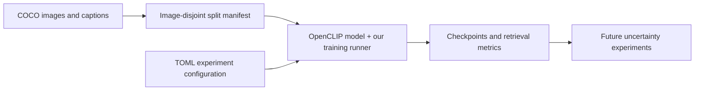
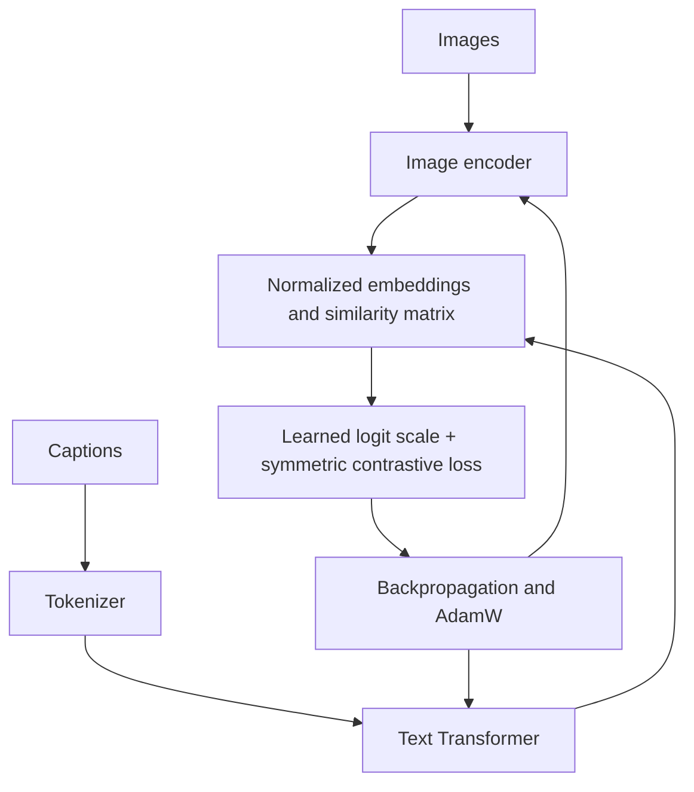

# CLIP project explained

We train an image encoder and a text encoder together from random weights on
COCO captions. The default image encoder is **ViT-B/32**. We reuse OpenCLIP's
architecture, tokenizer, image transforms, and contrastive loss, and implement
our own data splits, experiment runner, checkpoints, and retrieval evaluation.

## What exists now

The dataset is downloaded and split by image ID. Model, retrieval, and
checkpoint/resume tests pass. A tiny CPU run on four real training images
completed one epoch, evaluated retrieval, and saved `best.pt` and `last.pt`
under `runs/vit-b32-smoke/`.

That run verifies the pipeline. It is too small to establish model quality.
The GPU pilot, full-data training, and uncertainty experiments remain pending.
The [training guide](training.md) contains commands and validation details;
the [roadmap](roadmap.md) covers remaining research work.

## CLIP and the encoder choices

**CLIP** is the image–text contrastive learning approach. **OpenCLIP** is the
library used to construct the networks. **ViT-B/32**, **ViT-B/16**, and **RN50**
are supported model configurations; one is selected for each run.

| Image encoder | How it processes a 224 × 224 image |
| --- | --- |
| ViT-B/32 | Transformer over 49 image patches, each 32 × 32 pixels |
| ViT-B/16 | Transformer over 196 image patches, each 16 × 16 pixels |
| RN50 | Modified ResNet-50 with convolutional layers and attention pooling |

B/16 supplies finer spatial detail with more compute per image. The
[original CLIP paper, Table 11](https://arxiv.org/pdf/2103.00020) reports better
ImageNet zero-shot accuracy for B/16 than B/32 after large-scale training.
That does not establish which configuration works best when training from
scratch on COCO. The benchmark command measures runtime, not quality.

RN50 was the initial research proposal. Its rationale is preserved in the
[archived CNN review](archive/cnn-encoder-research.md). ViT-B/32 is now the default.
Stock RN50 and ViT configurations also differ in text width and embedding
dimension, so comparing them is a comparison of whole configurations.

## How learning works

Each training batch contains distinct images and one sampled caption per image.
The image encoder turns pixels into an embedding vector. The tokenizer turns
captions into token IDs, and the text encoder turns those IDs into embeddings.
Reusing the tokenizer does not reuse learned encoder weights.

For a batch of size 128, each image is compared with 128 captions: its matching
caption and 127 other captions. The loss rewards correct matches in both
directions. Both encoders and the logit scale train together.

$$
S_{ij}=\exp(\ell)\,\hat{v}_i^\top\hat{t}_j
$$

$$
\mathcal{L}=\frac{1}{2}\left[\operatorname{CE}(S,y)+\operatorname{CE}(S^\top,y)\right],
\qquad y=(0,1,\ldots,B-1)
$$

COCO has several captions per image. Sampling one per epoch avoids placing
the same image in a batch twice as if its captions were unrelated negatives.
Similar captions attached to different images can still create false negatives.

## Data and evaluation

| Split | Images | Purpose |
| --- | ---: | --- |
| Training | 118,287 | Learn weights |
| Validation | 1,000 | Select settings and checkpoints |
| Calibration | 1,000 | Fit future uncertainty calibration |
| Test | 3,000 | Final assessment after choices are fixed |

All captions for an image stay in its split. The manifest records annotation
hashes so changed data is rejected. This is our custom COCO 2017 protocol.

Evaluation measures image-to-text and text-to-image retrieval. Recall@1/5/10
is the fraction of queries with a valid match among the first 1, 5, or 10
results. Evaluation includes every caption for each selected image. Candidate
pool size matters, so comparisons must use the same pool.

The runner evaluates the random model, then evaluates after each epoch.
`best.pt` selects the completed training epoch with the highest average of the
six retrieval scores. `last.pt` stores optimizer state too, for resuming at an
epoch boundary. Neither checkpoint from the four-image check is a useful
research-scale model.

## Where it runs and how to estimate time

Training runs on the machine where the command is launched. The implementation
uses one process and one device. `cuda` uses an available NVIDIA GPU; `cpu`
uses the processor. `auto` chooses CUDA if available, otherwise CPU. Apple
`mps` is explicit and untested. Remote access and university GPU scheduling
must be arranged separately.

The configurations provide a four-image CPU check, an 8,192-image GPU pilot
for three epochs, and a full-data starting recipe for five epochs.

The `benchmark` command times real COCO training updates for all three models,
after warm-up steps. It uses the training runner's update code and reports
throughput, GPU memory, and projected training time. It does not save trained
checkpoints, evaluate retrieval, or measure time to convergence. Evaluation,
checkpoint writing, setup, and queue time must be added to its estimates.

See [the training guide](training.md) for benchmark and GPU handoff commands.

## Files

| Path | Responsibility |
| --- | --- |
| `uncertainty_clip/model.py` | Random model construction and device selection |
| `uncertainty_clip/data.py` | COCO records, splits, and caption sampling |
| `uncertainty_clip/training.py` | Training, checkpoints, and resume |
| `uncertainty_clip/evaluation.py` | Retrieval metrics |
| `uncertainty_clip/benchmark.py` | Hardware timing and compute estimates |
| `configs/` | ViT-B/32 experiment settings |
| `tests/` | Data, model, runner, and benchmark checks |
| `utilities/download_coco.py` | Dataset downloader |

This Markdown note supports Obsidian's built-in Mermaid and math rendering.
Related notes: [[training]], [[roadmap]].
